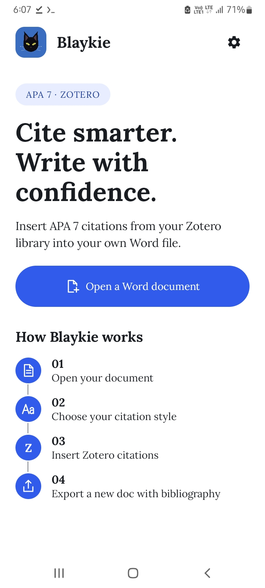
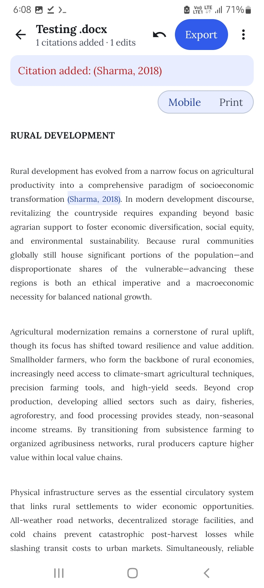
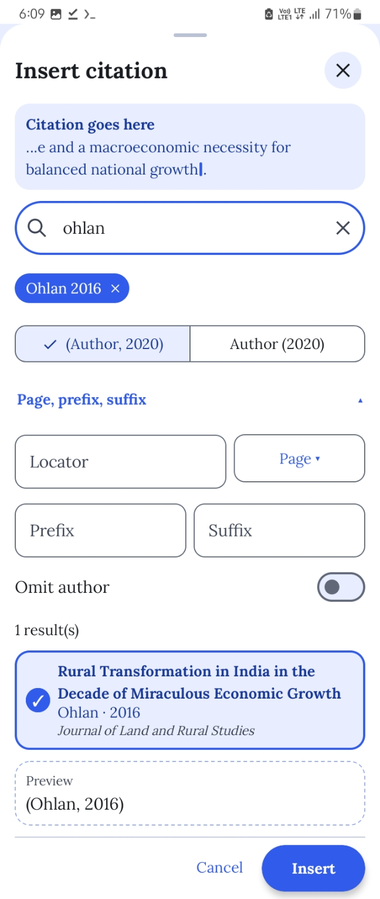
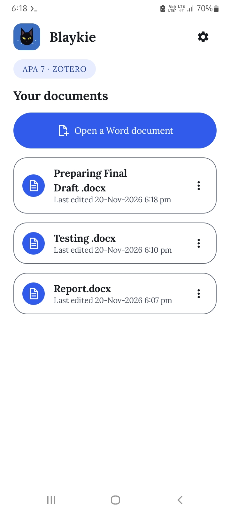
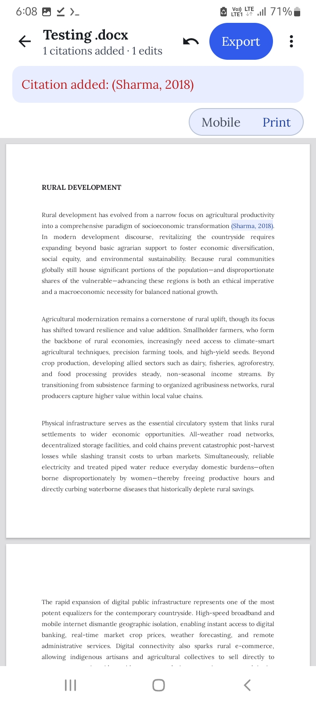
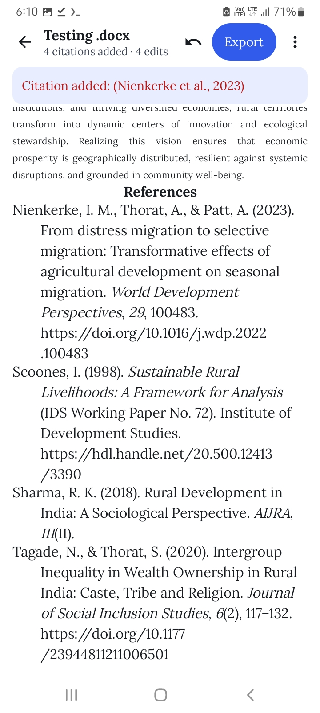

# Blaykie Citation Manager

**Add Zotero-style citations and a formatted bibliography to your Word file, right on your phone.**

Desktop-style citing on Android. APA 7 built in, plus your own citation styles.

[Download](https://github.com/avinashverse6/Blaykie/releases) · [What it does](#what-it-does) · [How to use it](#how-to-use-it) · [Beyond APA](#works-beyond-apa) · [Privacy](#privacy-and-safety) · [Compare](#how-is-this-different)

> **Not affiliated.** Blaykie is an independent project. It is not affiliated with, endorsed by, or connected to Zotero or Microsoft. "Zotero" and "Microsoft Word" are trademarks of their respective owners and are used here only to say what Blaykie works with.

  
  &nbsp;
  
  &nbsp;
  

## What it does

You write your essay, thesis chapter or paper in a normal Word (`.docx`) file. Blaykie lets you open that file on your phone, tap the place where a citation belongs, pick the source from **your own Zotero library**, and the citation is written into your text. At the end of the document, a **bibliography** is built for you, with hanging indent and italics where the style asks for them.

Then you export. Blaykie saves a **new copy** of your document. **Your original file is never changed.**

It is made for people who write on the move: students, researchers, and teachers in the humanities and social sciences who want proper citations without waiting to get back to a laptop.

## Why it exists

On a laptop, the Zotero plugin in Word puts a citation into your document with one click. On a phone, that has been missing: Word mobile does not have the usual citation tools, and Zotero's Android app is for managing your library and reading PDFs, not for placing citations inside your document. Blaykie fills that gap.

## How to use it

1. **Open your document.** Tap *Open a Word document* and pick your `.docx`.
2. **Tap where the citation goes.** Tap a paragraph in the document view. It works in both views: *Mobile* (text fits your screen) and *Print* (looks like a real page).
3. **Search and pick.** Search your Zotero library and choose one or more sources.
4. **Add details if needed.** Page number, chapter, a prefix like "see", a suffix, or hide the author, and check the live preview.
5. **Insert.** The citation appears highlighted in your text, and the bibliography at the end updates by itself.
6. **Export.** Blaykie saves a new `.docx` with everything in place. Open it in Word or Google Docs.

You can keep several documents in the app (for example, a paper and a proposal) and go back to any of them exactly where you stopped.

  
  &nbsp;
  
  &nbsp;
  

> The citations and references in these screenshots are sample data used only to show how the app looks. They do not represent the views or claims of the cited authors.

## Features

- **Cite in place.** Tap a paragraph, insert a citation, see it highlighted. Remove it or undo it any time.
- **Bibliography that builds itself.** Added at the end of your document and updated after every change, with hanging indent and italics.
- **Citation options.** Page, chapter, paragraph or section; prefix and suffix; "Author (2020)" or "(Author, 2020)"; omit the author; edit a citation later.
- **Two views.** *Mobile view* for comfortable reading, *Print layout* to see your pages.
- **Many documents, no losing your place.** Rename, delete, and resume each document with its citations and settings.
- **Your Zotero library.** Search and pick from your own library. Your Zotero key stays on your phone.
- **Hindi and Gujarati text** displays correctly.
- **Original file stays safe.** Blaykie always exports a new file.

## Works beyond APA

APA 7 is built in and works out of the box. If your field uses something else, you can bring your own style.

- Blaykie supports **Citation Style Language (CSL)** styles. Import a `.csl` file for your department, journal or university, for example an **ASA**, **Harvard** or **Chicago author-date** style, and Blaykie uses it for your citations and bibliography.
- This is **experimental** and **off by default**. Turn on *Custom citation styles (experimental)* in Settings, then import your style under *Settings → Citations*.
- Use independent **author-date** styles. Numbered and footnote styles are not supported yet.
- No styles are bundled with the app. You choose and import the files you need. Get them from the [CSL style repository](https://www.zotero.org/styles).
- Known limit: for Hindi and Gujarati author names, a custom style may join the surname and the given name without a comma. The built-in APA handles them correctly.

## How is this different?

Short answer: Blaykie is for **placing citations into your Word file on a phone**. It is not a library manager and not a word processor.

| | **Blaykie** | **Zotero for Android** | **Word mobile app** |
|---|---|---|---|
| Insert a citation from your Zotero library into your Word file on the phone | Yes | Not listed among its features | Not available, as far as we know |
| Bibliography built and updated automatically | Yes | Not listed among its features | Not available, as far as we know |
| Hanging indent and italics in the bibliography | Yes | Not listed among its features | Manual formatting |
| Manage and organise your library, read and annotate PDFs | No | Yes | No |
| Full word processing (tables, review tools, and more) | No | No | Yes |

*Comparison based on public documentation as of November 2026. Apps change, so please check each app's current features. Zotero's documentation describes inserting items into a word processor as something done from the Zotero desktop app, with the word-processor plugin.*

Blaykie works best **together** with the apps above: keep your library in Zotero, write in Word, and use Blaykie to put the citations in when you are on your phone.

## Privacy and safety

- **Your Zotero key stays on your phone**, stored encrypted. It is never written into your documents or logs.
- Blaykie has **no analytics** and no accounts. The app talks only to `api.zotero.org` to read your library. The button that helps you create a key opens `zotero.org` in your browser.
- **Your original document is never modified.** Citations are written only into the new exported copy.
- The app works with your own Zotero library using a key you create with **read-only** access.

## Install

1. Open the [**Releases**](https://github.com/avinashverse6/Blaykie/releases) page and download the latest `.apk` file.
2. Open the file on your Android phone (Android 7.0 or newer). If Android asks, allow installation from your browser or file manager.
3. To update later, download the newer `.apk` and install it over the old one.

There is one APK for all phones. Each release also has a `.apk.sha256` file so you can check that your download is untouched.

Check your download (optional)

Compare the SHA-256 of the downloaded `.apk` with the value in the `.apk.sha256` file. Official releases are signed with a certificate whose SHA-256 fingerprint is:

`7E:D9:EA:9F:95:80:B9:14:70:AB:53:CB:D7:C6:65:19:80:32:3C:92:3C:71:FD:F7:E7:39:26:71:B1:4F:3F:9A`

A debug build is a separate app with a different signature and does not share data with the release app.

## Get your Zotero key

1. Sign in at [zotero.org](https://www.zotero.org) and open **Settings → Security** (or [zotero.org/settings/keys](https://www.zotero.org/settings/keys)).
2. Create a new private key with **read** access to your personal library.
3. In Blaykie, paste the key on the first screen (or later under *Settings → Account*).

## What it can't do yet

- It is not a full word processor: you tap a paragraph and edit there, rather than typing freely on the page.
- Tables and protected parts of a document cannot be edited. Check the formatting after export.
- In *Print layout*, page breaks are close to Word's but not exact.
- Older citations that were not made in Blaykie can be removed but not edited.
- Numbered and footnote citation styles are not supported yet.

Planned next: sign in to Zotero without copying a key, page numbers and headers in the page view, and a typing editor.

## For developers

Blaykie is a native Android app (Kotlin and Jetpack Compose) in the [`native/`](native) folder. Builds and releases run on GitHub Actions. Custom CSL styles run through [citeproc-js](https://github.com/Juris-M/citeproc-js) in a hidden WebView. See [`docs/`](docs) for notes, [`THIRD_PARTY_NOTICES.md`](THIRD_PARTY_NOTICES.md) for credits, and the issue tracker for bugs and ideas. The repository root also contains an older prototype that is no longer maintained.

## Contributing

Bug reports and suggestions are welcome. Please [open an issue](https://github.com/avinashverse6/Blaykie/issues).

## License

Copyright (C) 2026 Avinash

Licensed under **AGPL-3.0-or-later**. See [LICENSE](LICENSE) and [THIRD_PARTY_NOTICES.md](THIRD_PARTY_NOTICES.md).

Versions released before this license change were MIT-licensed and remain MIT-licensed for those versions. The last commit on `main` carrying the MIT license was `2971cc3c3bcb86b497cf19e5d5c32263a1c02b6d` (2026-11-07 07:08:43 +05:30).

For other license requests, please use this repository's GitHub page.

---

Made by Avinash. Blaykie is not affiliated with Zotero.
